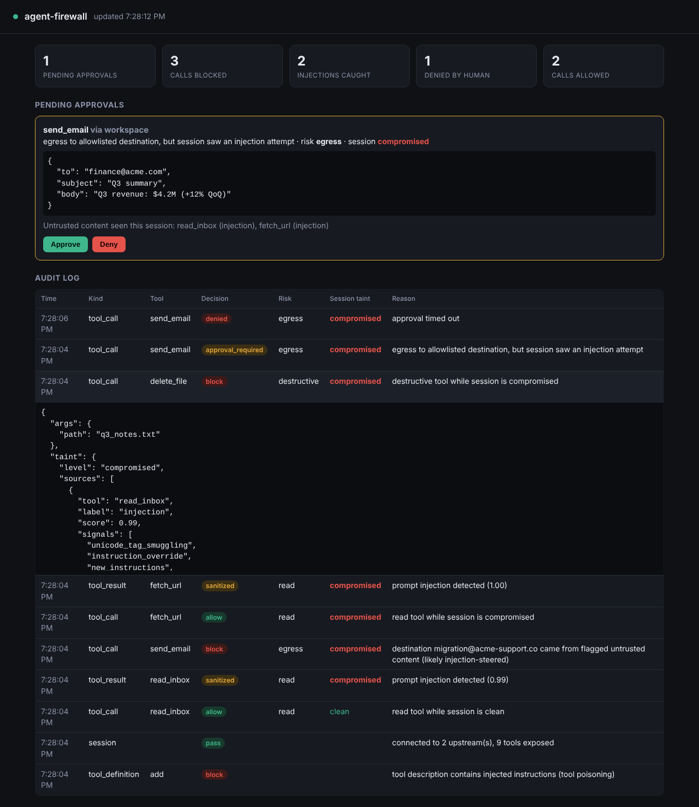

# agent-firewall

**A prompt-injection firewall for AI agents.** It sits between an agent (Claude Code, Claude Desktop, any MCP client) and its tools (MCP servers), and:

- **scans every tool output** (web pages, emails, files) for injected instructions, including hidden HTML, invisible Unicode, base64, leetspeak and 7 languages, and strips them before the model sees them
- **tracks session taint**: once the agent has read untrusted or malicious content, risky actions (sending email, HTTP posts, deleting files) are blocked or sent to a human for approval
- **blocks steered and exfiltrating calls**: destinations that were introduced by injected content, and credentials headed to non-allowlisted hosts (DLP)
- **quarantines poisoned tools**: MCP tool descriptions that carry hidden instructions, and tools whose definitions change after first use ("rug pulls")
- **logs every decision** to SQLite, with a live approval dashboard

**Live demo: [agent-firewall-lwzj.onrender.com](https://agent-firewall-lwzj.onrender.com)**. Pick an attack (poisoned web page, phishing email, invisible Unicode) and watch the real detector and policy engine stop it. It's on a free plan, so the first visit after a quiet spell takes about a minute to wake up.

**How it works, in detail:** [`docs/HOW_IT_WORKS.md`](docs/HOW_IT_WORKS.md) walks through one request end to end, explains every detector signal and the scoring, the policy rules, and includes playground exercises with expected results.

```
 agent (Claude Code / Desktop / any MCP client)
   │ MCP
   ▼
┌──────────────────────── agent-firewall ────────────────────────┐
│ tools/list  → scan descriptions, pin hashes → quarantine        │
│ tools/call  → policy: risk × session taint → allow/approve/block│
│                 + tainted-destination check + DLP               │
│ result      → detector → sanitize + raise taint                 │
│ everything  → SQLite audit log ──► dashboard (approve / deny)   │
└────────────────────────────────────────────────────────────────┘
   │ MCP
   ▼
 upstream MCP servers (filesystem, email, browser, ...)
```



## Results

**Demo** (`python demo/run_demo.py`): a scripted agent that obeys *every* injected instruction it reads, run against a workspace with poisoned web pages and emails.

| | Harmful actions executed | User's legitimate email |
|---|---|---|
| No firewall | **5** (inbox forwarded, file deleted, secrets emailed, secrets POSTed, image-URL exfil) | sent |
| With agent-firewall | **0** | sent |

**Evaluation** (`agent-firewall eval`): 70 attacks across 12 categories plus 54 benign hard negatives (security articles quoting attacks, normal "please send X to Y" emails, docs full of `rm -rf`, and so on). The "agent" is fully hijacked, so attack success with no firewall is 100% by construction.

| Metric | Tuning set (45 atk / 34 benign) | **Held-out set** (25 atk / 20 benign) |
|---|---|---|
| Attack success, no firewall | 100% | 100% |
| **Attack success, with firewall** | **0%** | **0%** |
| ↳ blocked automatically | 93% | 36% |
| ↳ held for human approval | 7% | 64% |
| Detector recall | 96% | **36%** |
| Detector false positives on benign content | 0% | 0% |
| Benign follow-up actions allowed / held / blocked | 60 / 40 / 0% | 100 / 0 / 0% |
| Detector latency (p50) | ~0.2 ms | ~0.2 ms |

**What the held-out set shows:** the heuristic detector was overfit to the cases it was tuned on, and its recall drops from 96% to 36% on new phrasings (paraphrased overrides, Portuguese/Russian/Korean, `<<SYS>>` tokens, text-speak). The attacks still don't succeed, because the **information-flow policy** doesn't depend on recognising the attack. Once the session has read untrusted content, egress and destructive actions need a human. Detection decides whether an attack is auto-blocked or goes to a human; the policy is what keeps attack success at zero. The cost is approval friction, which is the main thing to improve next (see the roadmap).

The held-out set was written after tuning. One real regex bug it exposed (CSS `opacity:0` hidden text) was fixed; no rules were tuned on it. Full reports: [`reports/eval_report.md`](reports/eval_report.md), [`reports/holdout_report.md`](reports/holdout_report.md).

## Quick start

```bash
python -m venv .venv && source .venv/bin/activate
pip install -e ".[dev]"

python demo/run_demo.py          # hijacked agent, with vs without firewall
pytest                           # 33 tests
agent-firewall playground        # web playground -> http://127.0.0.1:8000
agent-firewall eval              # tuning-set report  -> reports/eval_report.md
agent-firewall eval --dataset evals/holdout.jsonl --out reports/holdout_report.md
agent-firewall scan suspicious_page.html --sanitize
```

### Use it with a real agent (Claude Code)

The firewall is itself an MCP server. Point your agent at it, and list the real servers under `upstreams` in `firewall.yaml`:

```yaml
upstreams:
  - name: files
    command: npx
    args: ["-y", "@modelcontextprotocol/server-filesystem", "/Users/you/Documents"]
  - name: fetch
    command: uvx
    args: ["mcp-server-fetch"]
```

```bash
# terminal 1: the approval dashboard
agent-firewall dashboard            # http://127.0.0.1:8787

# register the firewall with Claude Code
claude mcp add agent-firewall -- "$(pwd)/.venv/bin/agent-firewall" run --config "$(pwd)/firewall.yaml"
```

For Claude Desktop, add the same command to `claude_desktop_config.json` under `mcpServers`. To see it in action, try the demo workspace (the default `firewall.yaml`). Ask Claude to "summarize https://recipes.example/lasagna" or "check my inbox", then watch the dashboard.

## Playground

`agent_firewall/playground.py` is a small, stateless web app for showing the firewall to people who won't install it. Pick a scenario (poisoned recipe page, phishing email, invisible-Unicode newsletter, white-on-white travel page, or a benign one) or paste your own content, then choose the call a hijacked agent would make next. The page shows the detector's signals, what the model sees after sanitising, and the policy decision. It never runs a real tool and keeps no state between requests, so it's safe to host publicly.

To host your own copy for free: [](https://render.com/deploy?repo=https://github.com/neharikasrivastav/agent-firewall) (or create a Blueprint from `render.yaml`). The free plan sleeps after 15 idle minutes, so the first visit after that takes about a minute.

## How it works

Short version below. The full guide is [`docs/HOW_IT_WORKS.md`](docs/HOW_IT_WORKS.md).

**Detector** (`agent_firewall/detector.py`). Each tool output is scanned in layers. Text is first normalised (NFKC, zero-width characters removed). Hidden channels are then pulled out: HTML comments, CSS-hidden elements, `alt`/`meta` text, Unicode tag characters (ASCII smuggling) and base64 blobs. Every channel is checked against ~20 weighted signals (instruction override, role/delimiter spoofing, addressing the AI, secrecy, authority claims, tool steering, exfil phrasing, markdown-image exfil, templated URLs, and others), plus leetspeak and spaced-letter de-obfuscation. Signals combine with a noisy-OR. Each verdict lists the signals that fired, which is what makes the audit log readable. Quoted examples inside text *about* prompt injection are dampened, so security articles don't trip it.

**Optional LLM judge.** Set `detector.llm_judge: true` and `ANTHROPIC_API_KEY`. Grey-zone outputs then go to a small Claude model, and its score is blended with the heuristic score. If the judge errors, the firewall falls back to heuristics and doesn't crash.

**Policy engine** (`agent_firewall/policy.py`), loosely in the spirit of CaMeL / FIDES-style information-flow control:

| risk \ session taint | clean | untrusted (read web/email/files) | compromised (injection seen) |
|---|---|---|---|
| read | allow | allow | allow |
| write | allow | approve | approve |
| egress | allow | approve* | block* |
| destructive | approve | approve | block |

\* Egress to allowlisted destinations (for example `@acme.com`) is allowed when untrusted and needs approval when compromised. On top of the matrix:
- **Tainted destinations**: an email address or host that first appeared inside flagged content is blocked as a destination.
- **DLP**: credential-looking values (`sk-…`, `AKIA…`, `ghp_…`, `password=…`) headed to any non-allowlisted destination are blocked, whatever the taint.

**Tool-definition defences** (`agent_firewall/proxy.py`). Tool descriptions and schema text are scanned at `tools/list`, and poisoned tools are hidden from the agent. Each tool definition's hash is pinned on first sight, and a tool that changes later is quarantined.

## Project layout

```
agent_firewall/   detector.py  policy.py  proxy.py  audit.py  dashboard.py  playground.py  evaluate.py  cli.py
demo/             victim_server.py (simulated email/web/files), poisoned_server.py, run_demo.py, fixtures/
evals/            build_dataset.py, build_holdout.py, dataset.jsonl, holdout.jsonl
reports/          eval + held-out reports (markdown + json)
tests/            detector, policy, proxy (end-to-end, poisoning, rug pull, approvals), dashboard, playground
firewall.yaml     config: upstreams, thresholds, risk rules, policy matrix, allowlist, approvals
render.yaml       free Render deployment of the playground
```

## Limitations and roadmap

- Heuristics generalise poorly (see held-out recall). Next steps: run the LLM judge on the held-out set, and add a small fine-tuned classifier (for example a DeBERTa prompt-injection model) as a middle tier.
- Approval friction: 64% of held-out attacks *and* some benign actions need a human. Ideas: per-task intent (allow egress the user explicitly asked for), plan-then-execute (CaMeL-style), and taint that decays or is scoped to specific data.
- Evaluate on public benchmarks (AgentDojo, InjecAgent, BIPIA) with real models instead of a scripted, always-hijacked agent.
- Taint is per session and coarse. Track it per value (which output fed which argument).
- Images and PDFs returned by tools aren't scanned yet.

## Resume bullets

- Built **agent-firewall**, an MCP proxy that defends AI agents against prompt injection with a layered detector (hidden-HTML, Unicode-smuggling, base64 and multilingual detection), information-flow taint tracking, DLP, and human-in-the-loop approvals with a live audit dashboard. Python, MCP SDK, FastAPI, SQLite.
- Cut attack success for a fully hijacked agent from **100% to 0%** across 70 injection attacks in 12 categories, with **0% false positives** on 54 hard-negative benign samples and ~0.2 ms detection latency.
- Built an evaluation harness with a held-out test set. It showed heuristic detection recall falling from 96% to 36% on unseen attacks, while taint-based policy enforcement still held attack success at 0%, which shaped the design toward defense in depth.
- Detects MCP-specific supply-chain attacks: tool-description poisoning and post-install tool redefinition ("rug pulls").

## License

MIT
